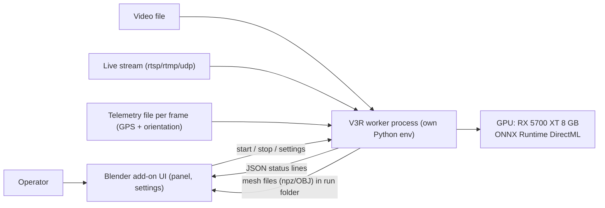
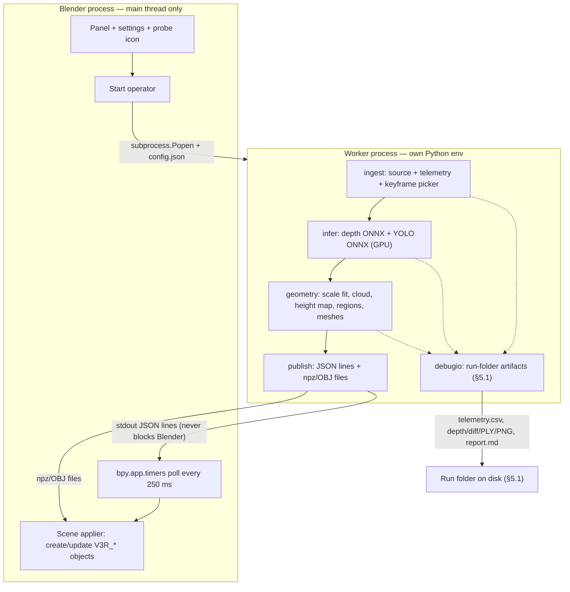
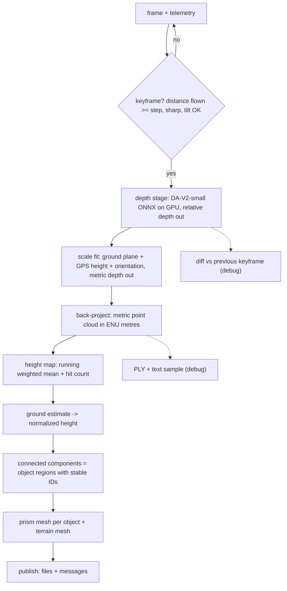
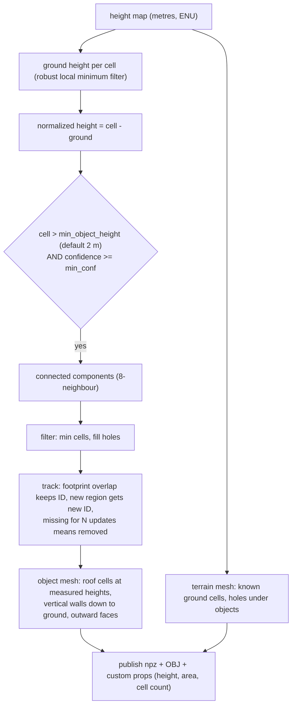
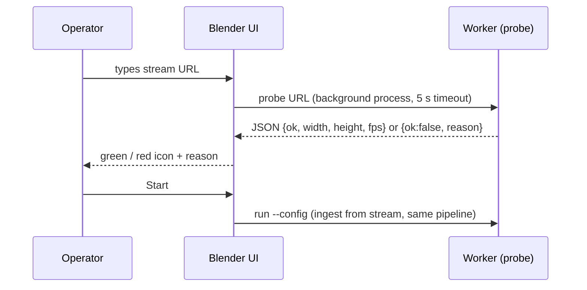
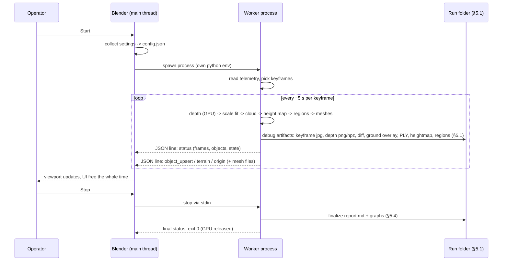
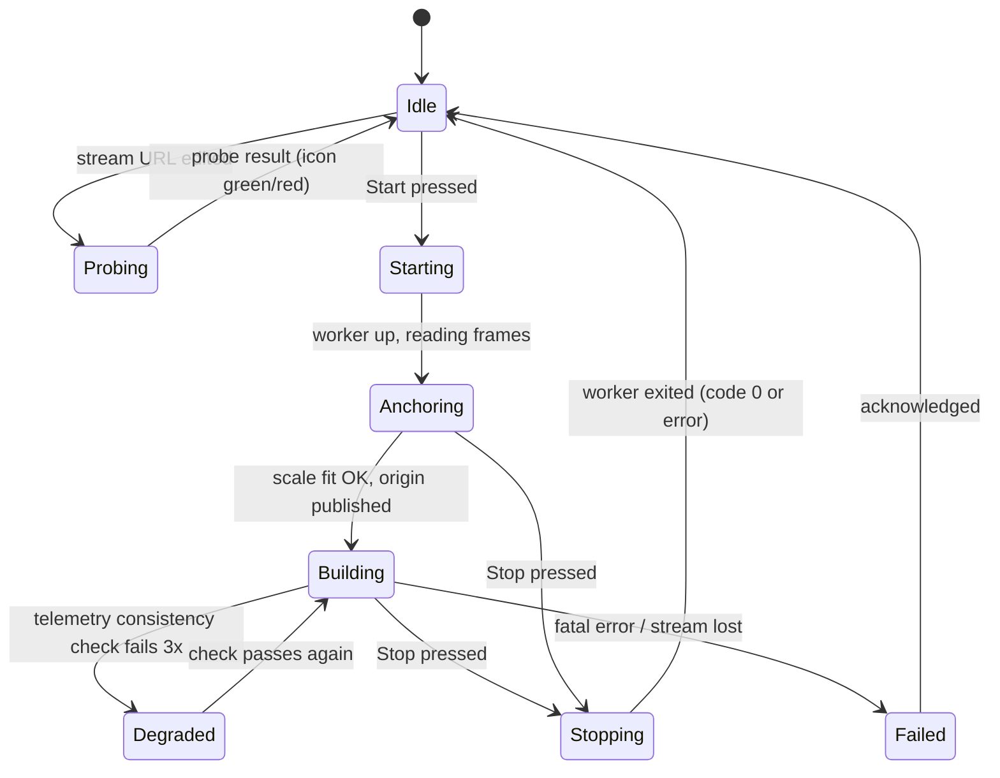
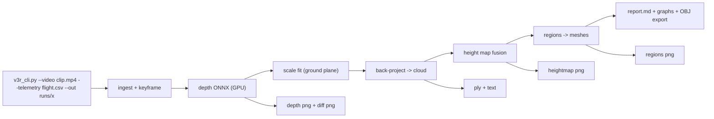

# V3R — Reality-Checked System Design and 1-Week Build Plan (v2)

*Team of 3 · Repo: [MARS3256/V3R](https://github.com/MARS3256/V3R) (Blender 5.2 add-on, GPL-3.0-or-later) · Written Nov 2026*

*Rev 2.1: debug/telemetry output made **binding for the MVP plugin run** (§1.1 item 9, §4.2, §4.7, Gate C) and for the **full-plugin roadmap** (§10 standing rule + §10.1). Debug output is a deliverable of both, never a CLI-only feature.*

**Hard constraints given by the team (non-negotiable):**

| # | Constraint | Consequence for design |
|---|---|---|
| C1 | Target GPU: **AMD RX 5700 XT 8 GB, Vulkan-era driver**. 16 GB DDR4 | No CUDA. No PyTorch at runtime. Inference = ONNX on AMD via DirectML (D3D12) or NCNN (Vulkan). See §3 |
| C2 | **No CPU-bound architecture** — GPU does the heavy work | Every neural network runs on the GPU. CPU only does light geometry at keyframe rate. Budget proof in §3.5 |
| C3 | Target output: **accurate building positions and structure**; buildings, trees, humans, complex objects replaced by **simplified models with correct sizes** — not photorealistic | 2.5D height-map + extruded/prism meshes + proxy models. No dense photogrammetry, no Gaussian splats, no heavy meshing |
| C4 | MVP this week: plugin takes **video file or stream**, processes **without blocking Blender**, creates 3D objects in the scene. Textures = declared placeholder (extension point), real projection in full app | See §1 and §10 |
| C5 | First deliverable: **CLI-only test script** (video → depth maps → point clouds) proving the procedure, with **debug artifacts at every stage** | See §5 and §6 |
| C6 | Strict code-smell and modularity rules; everything human-readable at every stage; undergraduate-comprehensible complexity | See §8 |
| C7 | No fake fallbacks, no "temporary" code. Unfinished features = numbered TODOs, never imitated | See §8 rules and §10 register |

**How to use this document.** §1–3 are decisions and the evidence behind them — read once. §4–7 are the design — the source of truth for what to build. §8 are the rules every human and AI coder must follow. §9 is the week plan; each task card is a copy-paste prompt for an AI coder. §10–11 are the future. Diagrams are all Mermaid, one concern each, small on purpose (maintenance rule in §4.0).

---

## 0. Reality audit — what was wrong with the previous plan, and what changed

The previous plan (V3R_build_plan.md) was built around running multi-view feed-forward reconstruction models (Pi3 / VGGT-Omega / MapAnything, from the On-the-Fly3R paper) on an 8 GB GPU, and treated "will it fit in 8 GB" as a Task 6 question while designing everything else as if the answer were yes. On your actual hardware and constraints, that core bet is wrong, not risky. The corrected decisions:

| # | Previous plan claim | Reality (checked Nov 2026) | Decision in this plan |
|---|---|---|---|
| A1 | Run a multi-view feed-forward 3D model (VGGT-class) on the 8 GB GPU | VGGT-1B users on an RTX 3060 8 GB report it needs **more than 24 GB** ([facebookresearch/vggt issue #270](https://github.com/facebookresearch/vggt/issues/270)). All these models ship as PyTorch + CUDA only. Depth Anything 3's multi-view variants were trained on 128× H100 ([repo](https://github.com/bytedance-seed/depth-anything-3)) | **Excluded.** Not a "measure it later" item — it is settled by hardware math |
| A2 | "ONNX + DirectML / ncnn-Vulkan" as interchangeable backends for the 3D model | No ONNX or ncnn builds of VGGT/Pi3/MapAnything exist. Converting attention-heavy multi-view transformers to DirectML/Vulkan is a research project by itself, not a task | Only models that **already have ONNX weights** are candidates. That means monocular depth, not multi-view 3D |
| A3 | Metric depth from a fine-tuned model as a possible route | The official DA-V2 metric checkpoints produce **broken/very poor results after ONNX conversion** ([Depth-Anything-V2 issue #49](https://github.com/DepthAnything/Depth-Anything-V2/issues/49)), and the metric-outdoor model was trained on Virtual KITTI (street-level driving, not aerial nadir) — wrong domain | **Relative depth + geometric metric scaling from GPS/IMU** (§4.4). One unknown (a scale factor) fitted from the ground plane per keyframe. Deterministic, testable, no model-domain gamble |
| A4 | "Vulkan via ncnn" listed as a working backend option | ncnn runs its own model zoo (YOLO etc.) via Vulkan; it does not run arbitrary HuggingFace transformers. No official ONNX-Runtime Vulkan execution provider exists | Primary stack = **ONNX Runtime + DirectML** (AMD's own documented path for inference on Radeon, [gpuopen guide](https://gpuopen.com/learn/onnx-directlml-execution-provider-guide-part1)). NCNN-Vulkan = measured option B for YOLO-class models. Honest note: DirectML is D3D12, not Vulkan — but it is vendor-neutral GPU compute with **zero NVIDIA/CUDA involvement**, which is what the constraint actually requires. See §3.3 |
| A5 | PyTorch ROCm on the RX 5700 XT as a path | gfx1010 (RDNA1) is **officially unsupported** by ROCm ([issue tracker](https://github.com/ROCm/ROCm/issues/)) and only runs via community hacks | No PyTorch anywhere, including conversion steps. All chosen models have ready ONNX weights |
| A6 | 13 heavyweight tasks + 18 TODOs + "every setting has no default and Start stays disabled" in 5 days | That is 2× the achievable work for 3 people in one week, and the required-empty settings made the tool unusable before calibration even existed | **14 smaller task cards with 3 go/no-go gates** (§9). Settings get documented defaults from day one; values marked "measured later" (§4.10) |
| A7 | Per-image depth with per-image "deviation measurement" | Depth maps from single images have no shared metric scale — that criticism in the previous plan was correct | Kept the correction, but solved with **GPS/IMU-anchored ground-plane scaling** instead of a model-side alignment module (simpler, ~80 % less code, and your telemetry does the hard work) |
| A8 | Weighted alignment, robust re-weighting, batch rejection, pose-graph drift correction, image-fingerprint search | These solve problems you don't have: GPS/IMU gives camera pose and metric scale for free on every frame. The paper needed them because its images carry no position | **Dropped.** Replaced by one flight-data consistency check (§4.4.7). Remaining items live in the TODO register (§10) |
| A9 | Full textured photoreal pipeline as the goal | Re-targeted by the team: correct positions and structure with simplified models | Prisms/proxies + heights + footprints are the product. Texture projection = extension point (§10, TODO-101) |
| A10 | "Blender 5.2 API" assumed | Repo already targets Blender 5.2 with `bpy.app.timers` (current, documented). Risk is small but real for 5.x API churn | Rule 8 in §8: check installed Blender API docs, never assume from memory |

**What survives from the previous plan (it was right about these):** heavy work in a separate worker process; Blender applies updates on a timer and never waits; JSON-lines + mesh files as the contract; flight data per frame changes everything for the better; bad input is counted and reported, never faked. Those are standard, correct patterns — they stay.

---

## 1. Scope

### 1.1 MVP — the finish line this week

> A Blender 5.2 add-on where the operator picks a **video file** or enters a **stream link**, presses Start, and while Blender remains fully usable, separate 3D objects (terrain + raised structures) appear and update live, at correct real-world scale and position relative to the launch point, from drone video with per-frame GPS/IMU telemetry. Every pipeline stage writes debug artifacts to a run folder. A CLI tool with the same core modules produces depth maps, point clouds, and measurement reports from any video file.

Must be true at the end of the week (testable, no interpretation needed):

1. Video file mode: separate meshes (one terrain + N objects with stable IDs) appear in the Blender viewport while processing runs, and update as more frames are processed.
2. Stream mode: a connectivity probe shows connected / failed; Start begins the same live processing from the stream.
3. Blender stays interactive: orbit, select, edit while a run is active. The worker is a separate process; the Blender main thread never waits on it.
4. Stop always ends the worker within the stop timeout and releases the GPU runtime cleanly.
5. Positions and sizes are in metres in a local East-North-Up frame anchored at the launch point; the measured position/size error against known references is written into `RESULTS.md`.
6. The CLI harness (`v3r_cli.py`) runs the identical core modules and writes the full debug artifact tree (§5) plus `report.md`.
7. Running on the RX 5700 XT box via ONNX Runtime DirectML. No `import torch` anywhere in the repo (checked by lint rule, §8).
8. Texture projection exists as a declared, tested-at-the-interface extension point (`TextureProjector` stub raising `NotImplementedError(TODO-101)`), not as a button that pretends to work.
9. **A plugin run (Start → Stop) writes the same §5.1 artifact tree as the CLI** — keyframes, depth PNG/NPZ, diff, ground overlay, PLY, height map, regions, `telemetry.csv` — and on Stop finalizes `report.md` + graphs. The plugin is a research instrument: every demo run is also a measurement run for performance and result analysis (when PNGs are written is governed by §5.5).

### 1.2 Full plugin (after this week, §10)

Everything in §1.1 plus: per-object classification (building / tree / vehicle / human / complex object), simplified proxy models placed with correct position and size, texture projection from frames onto meshes, water-body surfaces, rubble handling, damage comparison against earlier scans, ODM-based offline refinement of finished areas.

### 1.3 Explicit non-goals (so nobody "improves" into a trap)

- Photorealism, dense per-pixel texturing, Gaussian splatting, NeRF.
- Real-time *per-video-frame* processing (30 fps). The physics of the flight makes keyframes every ~2–10 s sufficient (§4.4.3). "Live" = updates within seconds of a keyframe, not 60 fps meshing.
- Offline-grade survey accuracy (cm-level). Consumer GPS bounds absolute accuracy to metres (§4.4.8). We measure and report error; we do not promise cm.
- NVIDIA support, macOS, analog-FPV input quality magic.

---

## 2. Requirements

### 2.1 Functional

| ID | Requirement | Verified by |
|---|---|---|
| FR-1 | Read video files (mp4/avi/mkv/mov/webm) and live streams (rtsp/rtmp/udp/srt via FFmpeg) | CLI + plugin run |
| FR-2 | Read per-frame telemetry: GPS lat/lon/alt + roll/pitch/yaw + timestamp, format fixed from a real sample | T2 tests on the real sample |
| FR-3 | Select keyframes by distance flown, with blur and tilt rejection | Telemetry CSV shows decisions |
| FR-4 | Estimate relative depth per keyframe on GPU (ONNX) | Gate A measurement |
| FR-5 | Convert relative depth → metric depth via ground-plane scale fit using GPS height + orientation | Unit tests with known geometry |
| FR-6 | Back-project to a metric point cloud in local ENU metres; write PLY/NPZ/text | CLI artifacts |
| FR-7 | Fuse point clouds into a persistent height map (running weighted mean + hit count) | Unit tests: box heights converge |
| FR-8 | Segment raised regions → stable object IDs → prism meshes + terrain mesh | Unit tests: two boxes → two closed meshes |
| FR-9 | Publish meshes + messages to Blender; apply without blocking, bounded per-tick work | Task 9 + manual UI test |
| FR-10 | Stream connectivity probe with timeout; UI state icon | Task 11 |
| FR-11 | Every stage writes debug artifacts (§5); every run ends with `report.md` + graphs — in the CLI **and** in plugin runs (same core modules + `debugio`) | Gate B checklist (CLI) + Gate C (plugin run, §1.1 item 9) |
| FR-12 | YOLO person/object detection → ground-projected proxy markers (stretch, first cut if behind) | Task 14 |

### 2.2 Non-functional

| ID | Requirement | Target |
|---|---|---|
| NFR-1 | Non-blocking Blender | Main-thread work per timer tick ≤ 30 ms (setting) |
| NFR-2 | GPU duty cycle | Neural inference on GPU; GPU busy < 10 % of wall time at keyframe rate |
| NFR-3 | VRAM | Peak worker VRAM ≤ 3 GB (leaves headroom for Blender + OS on the 8 GB card) |
| NFR-4 | RAM (16 GB box) | Worker RSS ≤ 2 GB: ring buffer of ≤ 8 frames, height map bounded by area limit setting |
| NFR-5 | Latency to first visible object | ≤ 60 s of video processing after map anchor is established (status text says "waiting for anchor" before that — honest state, not a fake spinner) |
| NFR-6 | Readability | Any module explainable in ≤ 5 sentences to a second-year student; file ≤ 200 lines; function ≤ 30 lines |
| NFR-7 | Reproducibility | Every run writes a settings snapshot + model file hashes; two runs on the same input produce the same meshes (deterministic pipeline, no RNG) |

---

## 3. Feasibility study — the hardware truth (read before coding anything)

### 3.1 What the RX 5700 XT can actually run

| Stack option | Verdict | Evidence / reason |
|---|---|---|
| PyTorch + CUDA | **Banned** (C1). Target GPU is AMD | — |
| PyTorch + ROCm on RX 5700 XT | **Excluded.** gfx1010/RDNA1 not officially supported by ROCm; community hacks only, no stability guarantee | ROCm support tracker; community confirmations |
| Multi-view 3D foundation models (VGGT-1B, Pi3, MapAnything, DA3 multi-view) | **Excluded.** PyTorch/CUDA-only releases; VGGT-1B measured by users at > 24 GB on an 8 GB card; DA3 multi-view trained on 128 H100s | [vggt issue #270](https://github.com/facebookresearch/vggt/issues/270); [DA3 repo](https://github.com/bytedance-seed/depth-anything-3) |
| **ONNX Runtime + DirectML** on the RX 5700 XT | **Primary stack.** AMD's own published recommendation for inference on Radeon; DirectML supports GCN1st-gen and newer — RDNA1 included. Standard ONNX transformer ops run. Windows | [AMD gpuopen DirectML guide](https://gpuopen.com/learn/onnx-directlml-execution-provider-guide-part1); [Ultralytics ONNX/DirectML docs](https://docs.ultralytics.com/integrations/onnx) |
| NCNN (Vulkan compute) | **Option B, measured not assumed.** Works on RDNA1 via Vulkan (RADV on Linux / AMDVLK-Vertix on Windows) for models with existing ncnn ports (YOLO family). No arbitrary-transformer support | ncnn model zoo |
| Depth Anything V2 **Small** ONNX (25 M params, 99 MB, **Apache-2.0**) | **Primary depth model.** Ready-made ONNX weights, proven export, runs far under 8 GB at 518 px | [onnx-community/depth-anything-v2-small](https://huggingface.co/onnx-community/depth-anything-v2-small) |
| Depth Anything V2 Base/Large ONNX | Base/Large weights are **CC-BY-NC** (non-commercial). Usable for the capstone demo, **not** for any commercial release. Base = 389 MB ONNX | HF model cards |
| Depth Anything 3 **Small** ONNX (24.7 M params, Apache-2.0) | **Measured alternative** to DA-V2-small (newer, same size class). Community ONNX export exists — verify output sanity in Gate A before adopting | [onnx-community/depth-anything-v3-small](https://huggingface.co/onnx-community/depth-anything-v3-small) |
| Metric depth models via ONNX | **Excluded.** Documented broken/poor ONNX conversions of the official metric checkpoints; wrong training domain (street driving) for nadir aerial footage | [DA-V2 issue #49](https://github.com/DepthAnything/Depth-Anything-V2/issues/49) |
| YOLOv8n/YOLO11n exported to ONNX | **Primary detector** (stretch goal T13). Official Ultralytics ONNX export, runs under DirectML | [Ultralytics ONNX docs](https://docs.ultralytics.com/integrations/onnx) |

### 3.2 The "no PyTorch" rule, made enforceable

No module may import torch — not even for model conversion — because (a) you banned it, (b) ROCm doesn't support this card, (c) every chosen model already ships ONNX. Enforced by lint rule (§8, R12): a grep check fails CI if `import torch` or `from torch` appears anywhere outside `docs/`.

### 3.3 The Vulkan honesty note

You asked for Vulkan. Direct statement of facts so the plan contains no magic:

- There is **no ONNX Runtime execution provider for Vulkan**. Anyone who tells you "ONNX + Vulkan" for arbitrary models is wrong.
- **NCNN** is a real Vulkan-compute runtime, but only for models someone has hand-ported to ncnn layers. Its zoo covers YOLO-class CNNs, not ViT/DPT depth models with attention.
- **DirectML** is Microsoft's vendor-neutral GPU inference on D3D12 — it runs on your RX 5700 XT today, is AMD's documented recommendation for exactly this use case, and requires no NVIDIA anything.

Decision: DirectML primary, NCNN-Vulkan kept as a measured option for the YOLO stage only (and as the Linux path if you ever move the ground station to Linux, where RADV Vulkan 1.3 works on RDNA1). The backend is one setting (`compute_backend = directml | ncnn_vulkan | cpu_reference`), chosen at startup from what Gate A measured on the machine — a decision recorded in `DECISIONS.md`, not a runtime fallback.

### 3.4 Why monocular depth + telemetry geometry beats the multi-model approach here

| Criterion | Multi-view feed-forward model | DA-V2-small ONNX + GPS/IMU scale |
|---|---|---|
| Runs on RX 5700 XT 8 GB | No (>24 GB measured by users) | Yes, ≪ 3 GB (Gate A confirms) |
| Available without CUDA/PyTorch | No | Yes (ready ONNX) |
| Metric scale | Needs its own alignment module | Free from telemetry (ground-plane fit, §4.4.4) |
| Camera poses | Estimated (needs quality checks, retries, batch rejection) | Free from IMU/GPS, one consistency check |
| Code volume / complexity | High (matching, re-weighting, rejection logic) | Low (deterministic geometry, unit-testable) |
| Weak point | VRAM, export, licence | Depth edges less crisp; needs ≥ ~40 % of frame to be ground for scale fit (checked per frame) |

The failure mode of the monocular route is known and detectable (fit quality per frame → frame rejected and counted). The failure mode of the multi-view route on this hardware is "doesn't run". That asymmetry decides it.

### 3.5 The "no CPU-bound" proof (budget math)

Cadence: 1 keyframe per ~5 s of flight (§4.4.3). Per-keyframe cost (estimates; Gate A replaces each with a measured number on the real GPU):

| Stage | Where it runs | Estimate |
|---|---|---|
| Decode + resize | CPU (FFmpeg) | ~10 ms |
| Depth inference (DA-V2-small, 518 px, fp16) | **GPU (DirectML)** | 30–100 ms |
| Ground-plane scale fit | CPU (NumPy, on downsampled arrays) | 5–15 ms |
| Back-projection 1920×1080 → cloud → grid accumulation | CPU (NumPy vectorised) | 30–80 ms |
| Height-map merge | CPU | 2–5 ms |
| Region finding + prism meshing | CPU | 10–50 ms |
| YOLOv8n 640 px (stretch) | **GPU** | 10–40 ms |

Worst case ≈ 0.3 s of work per 5 s of video: GPU busy < 5 %, one CPU core < 7 %. The CPU work is vectorised array math at keyframe rate — the machine is I/O- and latency-bound, not compute-bound. If any stage measures > 250 ms on real hardware, the rule is: move it to the GPU (compute kernel) or cut its cost — never "accept a slow Blender".

Memory: ring buffer of 8 keyframes (1080p RGB ≈ 48 MB), height map for 1 km² at 0.5 m cells ≈ 4 M cells × 13 B ≈ 55 MB, transient cloud 2 M pts × 24 B ≈ 50 MB freed per keyframe. Worker RSS stays under ~1 GB. The 16 GB RAM constraint is comfortable.

### 3.6 Video source truth (stated once, honestly)

The capstone report's 5.8 GHz **analog** VTX path is too low-quality (resolution, noise, rolling artifacts) for depth estimation and photogrammetry of any kind. All development and all claims in this plan assume a **digital HD source**: recorded onboard HD video, or a digital HD downlink (e.g., OBS re-streaming a digital feed) at ≥ 1080p. Analog input is not a degraded mode we support quietly — it is out of scope, listed in the risk register (R1), and the UI reports "video quality below minimum" if frame statistics look analog-grade (blur/low-res heuristics, thresholds measured in Task 12).

---

## 4. System design

### 4.0 Diagram rules (so they stay useful)

One diagram = one concern. Node names must match module/class names in the repo. When you change a module, you update exactly its diagram and nothing else. If a diagram needs more than ~12 nodes, split it — never grow one mega-diagram.

### 4.1 Context (who talks to what)



### 4.2 Process architecture — why two processes

Blender's Python is the same interpreter as the UI: anything heavy there freezes the viewport, and shipping `onnxruntime` + `opencv` inside Blender's Python is dependency hell. Therefore: the **worker is a separate OS process** with its own Python environment; Blender only (a) writes a config file and spawns it, (b) reads its stdout without waiting, (c) applies mesh files on a timer. This also survives a worker crash — Blender shows the error and stays alive.



Hard rules: Blender never imports worker code; worker never imports bpy; the only channels are the config file, stdout lines, and the run folder. If the process dies, the timer notices, reports exit code + last log lines. The worker is the **single writer** of the run folder: identical core modules with `core/debugio.py` hooks produce the identical §5.1 tree in CLI and plugin runs. Debug data never crosses the JSON channel and never touches the Blender main thread, so instrumentation costs the UI nothing.

### 4.3 Core data pipeline



Dashed nodes are debug-only stages: they run always (they are cheap) but write artifacts only when Debug Mode is on, except the first run of any new dataset, which is always full-artifact (research-first rule, §5.5).

### 4.4 The geometry core (the actual procedure — this is the "best procedure" for the CLI test)

Everything here is deterministic math with unit tests. No model knowledge beyond "relative depth map in, metres out".

**4.4.1 Camera intrinsics from FOV.** One setting `camera_fov_x_deg`. Focal length in pixels: `fx = (W/2) / tan(fov_x/2)`, square pixels, principal point = image centre. The real calibration (checkerboard, 10 min) replaces this in Task 12 and becomes the default with the measurement written in `DECISIONS.md` — FOV-from-spec is the starting assumption, labelled as such.

**4.4.2 Pose from telemetry.** Each frame carries GPS lat/lon/alt + roll/pitch/yaw. Local frame: East-North-Up metres anchored at the first accepted fix (the origin message sent to Blender once). GPS altitude is treated as *relative to the launch point* — barometric/GPS vertical noise makes absolute elevation claims dishonest; the map's Z=0 is the launch altitude. Camera rotation = body orientation (roll/pitch/yaw) composed with the fixed camera mount rotation (default 15° forward tilt, one setting, confirmed in Task 12 from the flight check).

**4.4.3 Keyframe rule.** Footprint width at ground level: `F = 2·h_agl·tan(fov_x/2)`, with `h_agl = alt_telemetry − ground_ref_altitude`. Take a keyframe when the plane has flown `d_step = (1 − overlap) · F` metres since the last one (default overlap 0.65 → d_step = 0.35·F; at 100 m and 90° FOV: F = 200 m, d_step = 70 m ≈ every 5.6 s at 45 km/h). Plus: skip frames with blur score (Laplacian variance) below the adaptive threshold, or camera tilt beyond `max_tilt_deg`. Every skip is a row in the telemetry CSV with the reason.

**4.4.4 Metric scale fit — the heart of the procedure.** The depth model outputs relative depth `r(p)` per pixel (arbitrary units, monotonic with distance). One unknown, the scale `s`, converts it to metres: `D(p) = s · r(p)`.

1. Ground reference height `z_g` starts at launch altitude minus plane altitude → `h_agl` known.
2. Ground-pixel selection: pixels in the lower frame region where the relative depth map is smooth (local variance below threshold) — over a nadir-ish camera this is the open ground around structures. Water/smoke/shadow fail this smoothness test naturally and drop out.
3. For each ground pixel, its ray (from intrinsics + orientation, §4.4.1–2) intersects the plane `z = z_g` at a known metric distance `D_geo(p)`. This is pure geometry.
4. Robust one-parameter least squares over all ground pixels: `s = Σ w·r·D_geo / Σ w·r²` (weights = smoothness confidence), plus a median-based outlier rejection pass. Fit quality recorded (residual MAD).
5. If too few ground pixels (< 20 % of frame) or MAD above `max_fit_mad`: **reject the keyframe** (counted, logged with reason). No silent best-guess.
6. `ground_ref_altitude` is refined over time: the median of fused ground-cell heights feeds back into `h_agl` (a 5-line self-consistency loop; documented because it is the one place with circular dependency, resolved by using the launch-point value for the first 10 accepted keyframes).

Sanity anchor: at 100 m AGL, 90° FOV, ground pixels at frame bottom sit at ≈ 100–160 m slant range — the fit has a strong lever arm; this is why the nadir-ish mount makes the whole scheme work. Forward tilt of 15° *increases* the lever arm; it does not hurt.

**4.4.5 Back-projection.** For every pixel: `X_world = C + D(p) · R·d_cam(p)` where C = camera ENU position, R = orientation matrix, d_cam = normalised camera-ray direction. Output: `(N,3) float32` cloud + `(N,3) uint8` colour, immediately down-accumulated into the height map grid (the raw cloud lives for one keyframe, is written to PLY for debugging, then freed).

**4.4.6 Height map fusion.** Grid in ENU, cell size `cell_m = gsd · cell_factor` (gsd = `F/W`; defaults cell_factor 4 → 0.42 m at 100 m/90°/1920 px). Per cell: running weighted mean of Z (`Σw·z/Σw`), hit count, colour mean, confidence = f(hits, fit quality). Cells with hits < min_hits are **unknown** — never interpolated, never guessed; the mesh shows a hole there and the status reports coverage %. Adding observations only tightens estimates (this is the "gets more accurate over time" behaviour — a weighted mean, nothing exotic).

**4.4.7 Flight-data consistency check (replaces the paper's whole alignment/rejection apparatus).** After each accepted keyframe: the measured ground height at the footprint centre should match the fused map's ground height there; if |Δ| > `gps_consistency_tolerance_m` for 3 consecutive keyframes, the run enters the `degraded` state: processing continues, but the status banner shows "telemetry inconsistent — positions unreliable" and the run is flagged in `report.md`. No auto-correction magic in the MVP; the check exists so bad telemetry is *visible*, and Task 12 turns the observed errors into the camera-tilt/time-offset corrections (TODO-118 automates it).

**4.4.8 Position accuracy honesty.** Consumer GPS: 2–5 m horizontal CEP, worse vertical; orientation from a flight controller IMU: ~1–2° error → ≈ 1.7–3.5 m ground shift at 100 m AGL. So: **relative structure** (building shapes, heights, spacing) is strong — it comes from visual depth, which is scale-consistent within a frame — while **absolute placement** carries the GPS/IMU error. The MVP claims and measures structure quality; RESULTS.md reports absolute error against known references. Nobody writes "accurate" without a number next to it.

### 4.5 From height map to simplified models



- Buildings: prism-with-roof mesh, footprint polygon simplified with `cv2.approxPolyDP` (epsilon from a setting), height = P90 of cell heights. This *is* the "accurate position and overall structure" product.
- Trees/humans/vehicles/complex objects: **MVP marks the extension point** (`ObjectClassifier` interface returning `unknown_structure`); the full app (§10, TODO-102/103) classifies via context + YOLO and swaps the prism for a proxy model (cone-sphere tree, capsule human, box vehicle) with size from the height map / bounding box + depth.
- Terrain: rendered only where ground is known; unknown cells stay holes — visible honesty beats pretty guesses.

### 4.6 Stream mode

Same pipeline; only the ingest differs. Worker opens the URL with a bounded probe (default 5 s): success = width/height/fps JSON → UI shows green icon; failure = reason string → red. During the run, the ingest thread keeps only the newest frame (drop-oldest, counted), and if no frame arrives for `stream_lost_timeout_s` the run ends with `StreamLostError` — status shows it; nothing hangs.



### 4.7 Sequence: Start (file mode) and the live loop



The Blender-side timer applies at most `max_updates_per_tick` messages and returns before `tick_budget_ms` elapses — that is the entire non-blocking mechanism; no locks, no waiting, newest-version-wins queue.

### 4.8 Session state machine



`Anchoring` is the honest "we need ~10 accepted keyframes before the first publish" state (NFR-5) — the status text says exactly that.

### 4.9 Contracts (the whole interface, small on purpose)

Messages (one JSON object per line, worker → Blender; Blender → worker is only the line `stop`):

| type | fields | notes |
|---|---|---|
| `status` | state, frames_read, keyframes_used, keyframes_rejected, objects, coverage_pct, text | every 1 s |
| `origin` | lat, lon, alt_m | once, at anchor |
| `terrain` | version, file | file = npz path |
| `object_upsert` | object_id, version, file, height_m, footprint_area_m2, class | class = `unknown_structure` in MVP |
| `object_remove` | object_id | |
| `error` | code, message, fatal | never swallowed |

Mesh file (npz): `vertices float32 (N,3)`, `faces int32 (M,3)`, axes = Blender (X east, Y north, Z up), written to temp then atomically renamed. Config file: source kind, source, telemetry path, run folder, settings dict, model paths + SHA256. OBJ export exists only in the CLI harness for inspection. On Stop, the worker finalizes `report.md` + graphs (§5.4) before exiting 0 — identical files for plugin and CLI runs, so one analysis toolchain (§7) serves both.

### 4.10 Settings (defaults with reasons — fixing the "everything required, Start disabled" mistake)

One registry module (`core/settings.py`): every entry = key, label, type, default, unit, range, **one-line reason**. "Measured-later" entries still ship a working default, marked `provisional: true` — Task 12 replaces defaults from measurements and flips the flag. Nothing is hard-coded elsewhere; nothing is disabled waiting for the user.

| Group | Setting | Default | Reason |
|---|---|---|---|
| Camera | fov_x_deg | 90 | spec assumption, Task 12 calibrates |
| Camera | mount_tilt_deg / roll_offset / yaw_offset | 15 / 0 / 0 | team statement; flight check validates |
| Camera | image_long_side | 1280 | VRAM headroom + speed; Gate A may raise |
| Keyframes | overlap_ratio | 0.65 | standard mapping practice |
| Keyframes | max_time_gap_s | 6.0 | safety net if GPS speed data missing |
| Keyframes | blur_margin_ratio / max_tilt_deg | 0.5 / 45 | conservative starting points |
| Scale fit | min_ground_fraction | 0.20 | below this, fit is untrustworthy |
| Scale fit | max_fit_mad_m | 3.0 | generous vs GPS vertical noise |
| Scale fit | smoothness_window / smoothness_max_var | 9 / measured-later | ground-pixel selection |
| Scale fit | ground_ref settle keyframes | 10 | before feedback loop engages |
| Height map | cell_factor / min_hits / area_limit_km2 | 4 / 3 / 4 | §4.4.6; bounds memory |
| Objects | min_object_height_m / min_cells / keep_overlap / remove_after_updates | 2.0 / 25 / 0.3 / 5 | visible-structure floor |
| Perf | max_updates_per_tick / tick_budget_ms / stop_timeout_s | 6 / 30 / 10 | NFR-1 |
| Stream | probe_timeout_s / lost_timeout_s / queue_len | 5 / 10 / 8 | §4.6 |
| Compute | compute_backend | directml | Gate A decides; ncnn_vulkan optional |
| General | debug_artifacts | always_first_run | §5.5 |

---

## 5. Debug and telemetry design (the research-project requirement)

> Rule: **every stage that transforms data must emit (a) a machine-readable row, (b) a human-viewable artifact.** If you cannot look at a folder and see what the pipeline thought at step k, the stage is not done.

### 5.1 Run folder layout (written by `core/debugio.py`, the only module that touches paths)

```
runs/<run_id>/
  meta.json                    settings snapshot, versions, model SHA256, machine info
  report.md                    auto-generated end-of-run summary (tables below)
  telemetry.csv                one row per keyframe (columns §5.3)
  ingest/
    keyframes/frame_000123.jpg       chosen keyframes, numbered by frame index
    skipped.csv                      frame_index, timestamp, reason (blur/tilt/gap)
  depth/
    raw/frame_000123.npz             float32 relative depth
    png/frame_000123.png             magma colormap, human-readable
    stats.csv                        frame, min, max, median, p90, fit_scale, fit_mad
  diff/
    frame_000123.png                 colormap of |frame − previous keyframe|
    metrics.csv                      frame, mean_diff, changed_pixel_pct
  ground/
    frame_000123.png                 overlay: ground-pixel mask (green) on keyframe
  cloud/
    frame_000123.ply                 per-keyframe metric cloud ( coloured)
    text/frame_000123.txt            first 500 points as plain text (x y z r g b)
  heightmap/
    latest.npz                       z, hits, confidence, colour (for resuming/inspection)
    png/step_0007.png                shaded relief + coverage mask
  objects/
    step_0007/regions.png            instance-coloured mask overlay on latest keyframe
    step_0007/obj_0003.obj           per-object mesh (OBJ for humans, npz for Blender)
  detect/  (T13)
    frame_000123.jpg                 boxes drawn
    detections.csv                   frame, class, conf, bbox, ground_x, ground_y, est_height
  graphs/
    latency_per_stage.png            stacked bars per keyframe
    height_convergence.png           P90 height of 3 largest objects vs observations
    scale_fit_quality.png            MAD over time (telemetry sanity at a glance)
    object_growth.png                objects + coverage vs time
    frame_budget.png                 keyframe cadence vs target
```

### 5.2 Stage → artifact → purpose

| Stage | Always | Debug-only | Purpose |
|---|---|---|---|
| Ingest/keyframe | skipped.csv, telemetry row | keyframes/*.jpg | prove selection logic, audit blur/tilt decisions |
| Depth | stats.csv row | raw npz + png | spot model failure instantly |
| Frame diff | metrics.csv row | diff png | motion/occlusion context; paper-figure material |
| Scale fit | fit_scale, fit_mad in stats | ground overlay png | the one place the metric claim is earned — show the mask |
| Point cloud | PLY | text sample | shareable, openable in MeshLab/CloudCompare |
| Height map | latest.npz | relief png | convergence evidence (graph) |
| Segmentation/objects | objects in messages | regions.png | debug instance tracking (IDs stable?) |
| Detection (T13) | detections.csv | boxed jpg | later proxy-placement audit |
| Whole run | report.md + graphs | — | the compare-with-existing-systems deliverable (§7) |

**Both entry points, one artifact tree.** The CLI (`v3r_cli.py`) and the plugin's worker process share the same core modules and the same `core/debugio.py` calls, so a plugin Start → Stop run populates the identical §5.1 layout. The §7 metrics are computed from either run without conversion — performance and result analysis never depends on which front end started the pipeline.

### 5.3 telemetry.csv columns (one row per keyframe)

`frame_index, t_video_s, lat, lon, alt, roll, pitch, yaw, h_agl_m, footprint_w_m, d_since_last_m, blur_score, is_keyframe, skip_reason, depth_ms, fit_scale, fit_mad_m, ground_frac, cloud_pts, fuse_ms, regions, mesh_ms, total_ms, gpu_mem_mb`

### 5.4 report.md (auto-generated, zero hand-typing)

Sections: run summary (settings + source); keyframe yield table (accepted/rejected with reasons); scale-fit quality distribution; height-map coverage; object table (id, height, area, first_seen, last_updated, updates); latency table (per stage: mean/p95); comparison hooks (§7); "anomalies" list (every `Degraded` interval, every error code, with timestamps).

### 5.5 Cost control (debug must never become the bottleneck)

Artifacts are written on the worker thread between keyframes (idle time); PNG encoding is the only notable cost — so PNG images are written when Debug Mode is on **or** during the first run on any new input file (hash-tracked in meta.json). CSVs and npz/Ply are cheap and always on. This keeps the "research-first" behaviour without slowing demo runs. The Blender process pays **zero** debug cost: artifacts are written inside the worker between keyframes; nothing debug-related crosses the JSON channel or the main thread.

---

## 6. The CLI test harness — build this first (C5)

### 6.1 Purpose and procedure choice

`v3r_cli.py` is the pipeline with no Blender: file in, artifacts out. Its job is to prove the §4.4 procedure on real footage before a single line of UI code depends on it. The core modules (`ingest`, `infer`, `geometry`, `scene`) are written once and used by both the CLI and the worker — the plugin is the CLI plus a different publisher.

Why this procedure (versus the alternatives) — the decision table:

| Option | Verdict | Why |
|---|---|---|
| DA-V2-small relative depth + ground-plane GPS scale (chosen) | ✅ | runs on target GPU today; one unknown to fit; deterministic; every failure mode detectable per-frame; matches team's original "Depth Anything" idea, corrected for scale |
| Metric depth model ONNX | ❌ | documented broken ONNX conversions; wrong training domain (street driving) |
| Multi-view feed-forward (VGGT/Pi3/DA3-multi) | ❌ | >24 GB on 8 GB cards; CUDA/PyTorch only (§3.1) |
| Classical SfM+MVS (COLMAP/ODM) | ❌ for live (batch, CPU-hours); ✅ as **offline baseline** in §7 | gives pseudo-ground-truth DSM to score our live output |
| Stereo/feature-matching refinement of telemetry poses | ⏸ TODO-117 | only if flight-check shows IMU orientation too coarse; a decision made on measurements, not now |

### 6.2 CLI flow



### 6.3 Interface (v1 — keep this small)

```
python v3r_cli.py --video FILE [--telemetry FILE] [--out DIR]
                  [--max-seconds N] [--debug full|stats|off]
                  [--export-obj] [--backend directml|cpu_reference]
```

- `--telemetry` optional **for a v0 geometry dry-run only**: without it the CLI runs in `visual_only` mode (relative depth, no metric scale, clouds in pixel units) and stamps every artifact `UNSCALED`. This exists because flight-data samples arrive mid-week; it is a labelled mode, not a fallback that pretends to be metric.
- `cpu_reference` backend = same ONNX on CPU — used for debugging on any laptop; clearly slower; never the default.

### 6.4 Acceptance (Gate B, end of Day 3)

1. A real ≥ 3-min aerial clip runs end-to-end on the RX 5700 XT; artifact tree §5.1 fully populated.
2. `report.md` numbers exist for: keyframe yield, fit MAD distribution, coverage, object count, per-stage latency.
3. Synthetic unit tests pass: flat ground + two boxes of known height → two closed prism meshes with heights within tolerance (tests run without GPU by injecting a mock depth provider — the only mock in the repo, confined to `tests/`).
4. No keyframe is silently dropped: every reject has a reason row.
5. A 10-second sample runs in `visual_only` mode before real telemetry exists (unblocks T3–T8 from Day 1).

---

## 7. Evaluation — tables and graphs that make the comparison honest

**Baselines (run offline, once, on the same clips):**

| Baseline | What we take from it | Tool |
|---|---|---|
| ODM (or COLMAP+OpenMVS) | DSM + ortho + reference mesh on the same frames → pseudo-ground-truth heights and footprints | [OpenDroneMap](https://github.com/OpenDroneMap/ODM) — batch, no time pressure |
| Known-size references | 3+ objects with known dimensions (road width, car, court) → absolute error check | tape measure / map |
| OpenREALM / literature real-time mappers | architecture + reported latency context for the paper | [OpenREALM paper](https://arxiv.org/abs/2009.10492) |

**Our system's measured metrics (all auto-generated into report.md):**

| Metric | Definition | Graph/table |
|---|---|---|
| Time-to-first-object | video timestamp of first published object_upsert | report table |
| Footprint IoU | our building footprints vs ODM ortho footprints | per-object table + mean |
| Height RMSE | our object heights vs ODM DSM at same cells | table + scatter |
| Position error | centroid offset vs ODM (absolute, GPS-bounded) | table + CDF |
| Height convergence | P90 height vs number of observations | convergence graph (the "improves over time" proof) |
| Latency | per-stage ms, p95 | stacked bar graph |
| Yield | keyframes accepted/rejected %, coverage % | report table |
| Rejection transparency | every reject reason counted | table |

**Comparison rows for the paper** (carried from the earlier research, kept honest with citations): 3DAeroRelief (video→SfM+MVS→damage labels, batch); RescueNet/DA-SegFormer (2D damage segmentation, no 3D); commercial tools (Metashape/Pix4D — batch, paid); OpenREALM (real-time ortho/DSM, C++, CUDA-dependent 3D mode). Our differentiator column, filled only with measured numbers: **live, separate objects, metre-scaled, on 8 GB AMD GPU, no CUDA**.

Rule (accuracy policy, restated): every claim in RESULTS.md carries its measurement method; estimates are marked "estimate"; nothing is copied from a datasheet into a results table.

---

## 8. Code quality rules (strict; paste into every AI-coder prompt)

```
V3R CODE RULES — obey all. If a rule blocks you, STOP and say which one; do not route around it.

ZONES (import direction is one-way, downward)
 R1. blender/ — may import bpy. core/ — NEVER imports bpy, never imports blender/.
     models/ — only onnxruntime + numpy + cv2 preprocess. io_formats/ — file writers/readers.
     tests/ — may import everything; may use mocks. Nothing else may use mocks.
 R2. Only the Blender main thread touches bpy. The Blender side never blocks: poll, apply, return.
     The worker never imports bpy and never opens a window.

MODULE SHAPE
 R3. One file = one job. ≤ 200 lines/file, ≤ 30 lines/function, ≤ 4 params (else a frozen
     dataclass). Plain English names (no abbreviations except: id, url, fov, gpu, gpu_vram).
 R4. Every file starts with 2–4 comment lines: what it does, what it does NOT do.
     Every public function has a one-sentence docstring stating what it returns.
 R5. Type hints on every function signature. Data crossing module boundaries is a frozen
     dataclass, never a bare dict.
 R6. No globals, no singletons, no side effects at import time. Dependencies are passed in
     constructors.
 R7. No magic numbers outside core/settings.py. If a value could ever be tuned, it is a
     setting with a one-line reason (§4.10). Physics constants (2, 360, pi) may stay local.

HONESTY (the anti-sugarcoating rules)
 R8. No fake data, no placeholder meshes, no random outputs, no "return something plausible
     on failure". Mocks exist only inside tests/.
 R9. Raise specific error classes; catch only where you can act. "except: pass" is a code
     smell that fails review. Every failure surfaces as a counted row (telemetry/status), not silence.
 R10. Unfinished feature = "# TODO(V3R-1xx): <what's missing>" with the id registered in
      docs/TODO.md (§10). Do not create UI, settings, or messages for TODO features.
      Banned in code, comments, and commit messages: "MVP", "prototype", "temporary",
      "for now", "hack", "dummy", "quick and dirty".
 R11. Extension points (e.g., TextureProjector) are interfaces that raise
      NotImplementedError(TODO_id) — declared, tested at the interface level, never imitated.

TECHNOLOGY LOCK (constraint C1/C2)
 R12. Inference = ONNX Runtime only. NO import torch / from torch anywhere (CI grep fails
      the build). NO CUDA-specific calls. GPU stages must run via the compute backend
      abstraction (directml | ncnn_vulkan | cpu_reference) chosen at startup.
 R13. Anything CPU-side that grows past ~250 ms/keyframe must be reported in the task notes —
      it is an architecture violation, not a tuning problem.

GEOMETRY & TESTS
 R14. All geometry (§4.4) is pure: numpy in, numpy out, no files, no GPU, no clock. Each
      function has a test with a known analytic answer (synthetic boxes, known transforms).
 R15. Every task ends with: ruff format + ruff check + mypy (basic) + pytest green, and a
      ≤ 5-line summary of what changed. Tests may not require a GPU (inject a mock depth
      provider); one marked [gpu] smoke test runs only where the GPU exists.

READABILITY BUDGET
 R16. Any module you cannot explain to a second-year student in ≤ 5 sentences gets split
      before it merges. If a diagram in §4 no longer matches the code, fixing the mismatch is
      part of the task, never a follow-up.

REVIEW CHECKLIST (every PR): zones respected · sizes respected · settings not constants ·
 no banned words · no torch · errors surfaced not swallowed · diagram updated · tests green.
```

**Module map (the whole repo, one row per file):**

| Path | Job | Zone |
|---|---|---|
| `core/settings.py` | settings registry with reasons | core |
| `core/dataclasses.py` | Frame, FlightSample, KeyframeResult, Region, Messages | core |
| `core/geo.py` | lat/lon/alt → local ENU metres (pure) | core |
| `core/debugio.py` | the ONLY path/artifact writer (§5 tree) | core |
| `ingest/source.py` | video/stream readers (FFmpeg/OpenCV), drop-oldest | core (no bpy) |
| `ingest/telemetry.py` | telemetry reader + interpolation + format from real sample | core |
| `ingest/keyframe.py` | distance/blur/tilt keyframe rule | core |
| `models/depth.py` | DA-V2-small ONNX wrapper (preprocess/postprocess) | models |
| `models/detector.py` | YOLO ONNX wrapper (T13) | models |
| `geometry/scale_fit.py` | ground-plane scale fit (pure) | core |
| `geometry/backproject.py` | depth → ENU cloud (pure) | core |
| `geometry/heightmap.py` | fusion grid (pure) | core |
| `geometry/regions.py` | components + tracking (pure) | core |
| `geometry/meshing.py` | prism/terrain mesh builders (pure) | core |
| `scene/texture_projector.py` | interface stub → TODO-101 | core |
| `scene/publisher.py` | messages + npz writer | core |
| `worker/app.py` | worker main: wires everything, stdin stop, status | core |
| `blender/panel.py`, `blender/operators.py`, `blender/applier.py`, `blender/process_manager.py` | existing repo files, extended per T9–T11 | blender |
| `v3r_cli.py` | CLI harness (§6) | top-level composition |
| `tests/…` | pure-geometry tests, contract round-trip, applier fake-bpy | tests |

---

## 9. The one-week plan (3 people, interchangeable, gated)

### 9.0 Ground rules

- **Gates are go/no-go, not vibes.** If a gate fails, the listed pivot happens *that day* — decided in a 15-minute meeting, written in `DECISIONS.md`, and only then does work continue. No silent plan-drift, no runtime fallbacks invented later.
- **Interchangeability:** every task card owns disjoint files (module map, §8) and states its inputs/outputs, so any person or AI can take any card after T0. Paste §8 rules + the card into the AI tool. That's the whole handoff protocol. **Ready-made:** `V3R_Coding_Agent_Prompts.md` (same folder) contains T0–T13 as self-contained, paste-ready agent prompts — each embeds the project facts, the verbatim §8 rules, exact interfaces/contracts, debug-artifact duties, tests, and the done-when checklist; copy one fenced block per card, no other context needed. Parallel-safety per day and the gates are in its appendices.
- **Cut order if behind** (drop from the bottom, never from the middle): T13 (YOLO) → T11 (stream probe icon polish; keep raw URL mode) → OBJ export → PNG re-render of *past* runs (the current run still writes CSVs always, and full PNGs on the first run of any dataset per §5.5) → **never** T2–T9, and never the §5 instrumentation itself.
- Daily 20-min sync: each person shows one artifact (a PNG, a table row, a green test) — artifacts are the progress language of this project.

| Day | Focus | Gate at end of day |
|---|---|---|
| 1 | T0 skeleton + T1 GPU proof + T2 ingest | **Gate A** |
| 2 | T3 depth + T4 geometry + T5 scale fit | — |
| 3 | T6 height map + T7 regions/meshes + T8 CLI assembly | **Gate B** |
| 4 | T9 Blender process side + T10 worker app → first end-to-end | — |
| 5 | T11 stream mode + T12 polish + non-blocking verification | **Gate C** |
| 6 | T12 measurements + RESULTS.md + T13 (stretch) | numbers exist |
| 7 | Demo, tag v0.1, archive plan, TODO register reviewed | release |

### Task cards

**T0 — Skeleton, contracts, debug IO (1 person, ~3 h, blocks everything)**
Files: `core/dataclasses.py`, `core/settings.py`, `core/debugio.py`, `core/geo.py`, `docs/DECISIONS.md`, `docs/TODO.md`, tests for round-trips and geo. Get the real 10-s video + telemetry sample FIRST; write the exact telemetry format (column names, units, angle conventions, altitude reference) in DECISIONS.md from the sample — from the file, not from memory of what the drone team "said".
Done when: tests pass; `debugio` creates the §5.1 tree; ENU conversion round-trips a known coordinate.

**T1 — GPU proof spike (Gate A owner, ~4 h incl. measuring)**
Files: `models/depth.py`, `scripts/gate_a_bench.py`, DECISIONS.md entry.
Download `onnx-community/depth-anything-v2-small` + `depth-anything-v3-small` ONNX; install `onnxruntime-directml`, `opencv-python`, `numpy`, `scipy` in a clean venv (NOT Blender's python). Run both on 5 real frames from the sample at 518 px; record ms/frame + peak GPU memory (Task Manager + `meta.json`); verify depth maps look sane (write the PNGs, look at them). Same for YOLOv8n ONNX if T13 will run. Backend decision (directml primary) recorded with numbers.
**Gate A pass =** depth ONNX runs on the RX 5700 XT at ≤ 200 ms/frame, ≤ 2 GB VRAM, visually sane output. **Gate A fail pivot:** try ncnn port path for depth OR (last resort, decided same day) cpu_reference with reduced image size — plan revision written before any other task continues.

**T2 — Ingest + telemetry + keyframe (≈ 5 h)**
Files: `ingest/source.py`, `ingest/telemetry.py`, `ingest/keyframe.py`, tests. Video file reading (as fast as asked, not paced), stream probe (bounded timeout), telemetry `at(t)` interpolation (angles wrap 360°), keyframe rule (§4.4.3) with every decision row in telemetry.csv/skipped.csv.
Done when: CLI-less test drives 3 min of the sample; keyframe decisions match hand-check on 5 frames.

**T3 — Depth stage + artifacts (≈ 4 h, after T1+T2)**
Files: `models/depth.py` postprocess, debug artifacts (depth png/npz/stats), diff stage. ONNX input preprocessing (resize 518, normalize) and output decode documented against the model card; diff vs previous keyframe written per §5.
Done when: depth PNGs for 20 keyframes look structurally correct; stats.csv populated; latency column real.

**T4 — Back-projection + writers (≈ 5 h)**
Files: `geometry/backproject.py`, `io_formats/ply_writer.py`, tests. Ray construction from intrinsics+orientation (§4.4.1–2, §4.4.5); cloud in ENU metres; PLY + 500-point text sample writers.
Done when: synthetic test — camera at known pose over a plane with one 10 m box → cloud reproduces plane at z≈0 and box top at z≈10 ± tolerance.

**T5 — Scale fit (≈ 5 h, the heart — pair on this one)**
Files: `geometry/scale_fit.py`, `ground/` overlay artifact, tests. Ground-pixel selection (§4.4.4), robust one-parameter fit, MAD quality, rejection path. Works in `visual_only` mode without telemetry (UNSCALED stamped).
Done when: synthetic frame with known geometry recovers scale within 5 %; a doctored "water" frame (smooth low-texture region) is rejected with the right reason.

**T6 — Height map (≈ 4 h)**
Files: `geometry/heightmap.py`, tests, heightmap artifacts. Fusion (§4.4.6), unknown cells stay unknown, ground_ref feedback loop after settle count.
Done when: 30 synthetic observations of a 12 m box converge monotonically toward 12 m (convergence test); unknown cells raise on access rather than return 0.

**T7 — Regions + meshes (≈ 6 h)**
Files: `geometry/regions.py`, `geometry/meshing.py`, tests. Connected components, min-size filter, ID tracking by overlap, prism+roof mesh with closed geometry (every edge shared by exactly two faces), terrain with holes, OBJ+npz writers.
Done when: two separate synthetic boxes → two stable IDs and closed meshes; merge/split sequences tracked deterministically.

**T8 — CLI assembly (Gate B owner, ≈ 4 h)**
Files: `v3r_cli.py`, `report.md` generator, graphs. Wire T2–T7; generate §5.4 report + §7 graphs from telemetry.csv.
Done when: Gate B checklist (§6.4) ticks on the real clip.

**T9 — Blender process side (≈ 6 h)**
Files: `blender/process_manager.py`, `blender/applier.py`, `blender/operators.py` (extend existing Start/Stop), panel status. Spawn worker, JSON-line reader thread (never blocks), timer poll + bounded apply (§4.7), origin → collection custom props, object_upsert → in-place mesh replace (no duplicate objects), remove → delete.
Done when: a scripted fake worker (tests/) drives the applier: 200 upserts at 60/s keep Blender responsive and object versions deduplicate to newest.

**T10 — Worker app (≈ 5 h)**
Files: `worker/app.py`, `scene/publisher.py`. Config file in, stdin `stop`, status line every 1 s, anchoring state machine (§4.8), clean GPU release on exit, exit code 0 on stop, nonzero + error JSON on fatal.
Done when: headless run on real clip produces messages + files; Stop ends within stop_timeout; kill -9 mid-run leaves no half-written mesh (atomic rename verified).

**T11 — Stream mode in Blender (≈ 4 h)**
Files: `ingest/source.py` (stream), `blender/panel.py` (probe icon), worker probe command. Green/red/checked states per §4.6; OBS test: OBS → (rtmp/udp) → worker, one live 3-min session.
Done when: icon truthfully reflects a deliberately-broken URL vs a working one; live session produces objects.

**T12 — Measurements + docs (Day 6 owner, ≈ 6 h)**
Files: `docs/RESULTS.md`, settings defaults update, `docs/USER_GUIDE.md`. Run ODM offline baseline on the same clip (pre-installed, started Day 4 in background — ODM is CPU-slow, see §7); fill §7 tables with measured numbers; calibrate FOV + tilt from flight-check residuals; write install steps for the worker venv (tested, or marked untested).
Done when: RESULTS.md has zero empty cells and zero unlabelled estimates; finish-line §1.1 items all ticked or explicitly failed with reasons.

**T13 — YOLO proxies (stretch; first cut) (≈ 5 h)**
Files: `models/detector.py`, `geometry/detect_projection.py`, detect artifacts. YOLOv8n ONNX on keyframes; person/vehicle classes; project box bottom-centre via ray to ground plane → position; height from box top ray; publish `object_upsert` with `class` set, mesh = capsule (person) / box (vehicle) at measured size.
Done when: detections.csv + boxed jpgs for a clip with visible people; ≥ 60 % of manual detections present; positions land on the ground plane in the viewport.

### Gate definitions (copy into DECISIONS.md on Day 1)

- **Gate A (Day 1):** §T1. Fail → same-day pivot decision (ncnn depth path / cpu_reference with size cut). Nothing else proceeds on assumptions.
- **Gate B (Day 3):** §6.4 on real footage + telemetry. Fail → Day 4 becomes fix-day; stream mode (T11) drops to Day 6 and T13 is cut.
- **Gate C (Day 5):** §1.1 items 1–4 + 7 demonstrated live, and item 9 verified once on a real plugin run (run folder populated + report.md finalized on Stop). Fail → Day 6–7 fix only; demo shows the CLI artifacts + partial plugin honestly labelled.

---

## 10. Full-plugin roadmap (TODO register — nothing here is faked in the meantime)

**Standing rule — the full plugin keeps every §5 debug stage.** Each TODO below ships its own debug artifacts + telemetry columns in the same commit as the feature (§10.1); a TODO without its instrumentation is not done. Nothing moves to a separate logging system: the run folder and `telemetry.csv` grow, and the §7 analysis pipeline keeps working unchanged. Any new GPU stage must add its latency and `gpu_mem_mb` columns from day one — performance analysis is a feature requirement, not an afterthought.

### 10.1 Debug stages owned by full-plugin features

| TODO | Extra debug artifacts (same run folder, same `debugio`) | New telemetry.csv columns |
|---|---|---|
| TODO-101 Texture projection | `texture/qa_obj.png` per object (projected-UV check + the K chosen camera views); reprojection-error histogram in report.md | `tex_views_k`, `tex_reproj_px`, `tex_ms` |
| TODO-102 Classification | `objects/classification.png` (labels colour-coded over regions); class distribution + validation confusion table in report.md | `class_label`, `class_score` |
| TODO-103 Proxy models | `objects/obj_XXXX_proxy.glb`; proxy-vs-prism volume fit error row in report.md | `proxy_fit_err_m3` |
| TODO-104 Water bodies | `ground/water_mask_frame_XXXX.png`; water level time series CSV | `water_frac`, `water_level_m` |
| TODO-105 Rubble | `objects/rubble_score.png` (heatmap over building footprints); flagged-object table in report.md | `rubble_score` |
| TODO-106 Damage comparison | `compare/delta_heightmap.png`; per-object Δheight/Δfootprint table + histogram (own mini-report per compared pair) | n/a (offline analysis run) |
| TODO-107 ODM refinement | `refine/tile_k_before_after.png`; live-vs-refined height delta stats in report.md | `refine_delta_p95_m` |
| TODO-109 Human markers | `detect/track_XXXX_path.png` (ground tracks over ortho/height map); dwell-time table | `active_tracks` |
| TODO-110 Multi-strip | `heightmap/strip_overlap.png`; per-strip scale-fit MAD comparison table | `strip_id` |
| TODO-113 Linux backend | backend bench table appended to report.md; same telemetry.csv schema with backend tagged | `backend` |

All other TODOs (111/112/114–118) keep §5 as-is; calibration and resume features write their own small JSONs into the run folder (`calibration.json`, `resume_state.json`) so runs stay reproducible.

| ID | Feature | Design sketch (lives in docs/ when started) | Done when |
|---|---|---|---|
| TODO-101 | Texture projection | `TextureProjector` interface (§8 R11): per object, pick K frames whose footprint covers it (known poses), project frame colours onto mesh UVs via ray-cast from camera; fallback = height-map colour layer already stored | Objects show real image colour from the correct frames |
| TODO-102 | Object classification | Context classifier on footprint + heightmap + colour stats: building / tree / vehicle / other | Each object has label + score, validated on a labelled clip |
| TODO-103 | Proxy models for trees/humans/vehicles/complex objects | Swap prism for parametric proxy (cone-sphere, capsule, box) sized from height map + detections (T13 feed) | Proxies at correct position + size in viewport |
| TODO-104 | Water bodies | Smooth low-gradient + low-normalized-height + colour region → flat translucent surface at observed level | Water surface rendered on flood clip |
| TODO-105 | Rubble | Roughness metric on height map over building footprints → rubble proxy mesh | Rubble flagged on known-rubble footage |
| TODO-106 | Damage comparison | Register two runs (same origin), per-object Δheight/Δfootprint → damage class | Deltas match known damaged/undamaged pairs |
| TODO-107 | ODM background refinement | Finished area → ODM run offline → refined tile swaps live meshes | Refined tile replaces live one, IDs preserved |
| TODO-108 | Absolute georeferencing export | ENU → WGS84 GeoJSON/KML of footprints | Footprints align with satellite imagery |
| TODO-109 | Human markers + dwell tracking | T13 detections tracked across keyframes → persistent markers | Marker with measured miss rate |
| TODO-110 | Multi-strip flights | Cross-strip join via footprint overlap + origin re-anchor | Two-strip clip builds one map |
| TODO-111 | Height-map compute-shader fusion | Move cell accumulation to GPU compute if profiling ever shows CPU fusion > 5 ms/keyframe | Same results, lower CPU time |
| TODO-112 | Resume interrupted runs | heightmap/latest.npz + meta → resume flag | Run continues with prior state |
| TODO-113 | Linux ground station | ncnn/RADV path for depth+YOLO (Gate A extension) | Same outputs on Ubuntu + RX 5700 XT |
| TODO-114 | Automatic camera calibration | Checkerboard task + flight-check residuals → replace FOV/tilt defaults | Calibration from one flight, error reported |
| TODO-115 | On-the-fly3R-style batch quality pass (offline) | Optional post-run global refinement where hardware allows | Measured error drops on benchmark clip |
| TODO-116 | Analog FPV intake (research-only) | Quality gate + upscale experiment | Honest report on why it fails/succeeds |
| TODO-117 | Visual pose refinement of telemetry | Feature-match keyframe pairs to refine IMU poses (only if flight-check shows need) | Measured position error drops |
| TODO-118 | Auto telemetry offset correction | Fit constant time/angle offsets from consistency-check residuals (§4.4.7) | Offsets learned from one flight |

Texture projection design (for TODO-101, decided now so the MVP extension point is stable): the stored per-cell colour mean (§4.4.6) is layer 0 (already built, shows vertex-colour). True projection (layer 1): for each mesh vertex, cast ray to each of K covering cameras; take the two best-angle views; assign UVs from their image planes; texture = downsampled keyframe JPGs from `ingest/keyframes/`. No new capture logic needed — the debug artifacts *are* the texture source. That is why the artifact discipline pays for itself.

---

## 11. Risk register (honest, each with detection and response)

| # | Risk | Detect | Response |
|---|---|---|---|
| R1 | Analog FPV video unusable for depth | blur/resolution stats on first sample (T2) | Digital HD source required for all claims (§3.6); report documents the limitation |
| R2 | Telemetry format differs from assumptions / angles ambiguous | T0 writes format from real sample; flight check residuals (§4.4.7) | Fix parser to sample, not vice versa; offset correction TODO-118 |
| R3 | DirectML slow or broken on RDNA1 for ViT+DPT depth | Gate A numbers | ncnn depth port OR cpu_reference with reduced size — decided Day 1, never silently |
| R4 | Ground-pixel selection fails (dense urban frame, little open ground) | ground_frac < min_ground_fraction, rejected keyframes pile up | Lower fly height / longer overlap in flight plan; TODO-117 refines poses; report shows yield honestly |
| R5 | GPS vertical noise → wrong scale → wrong heights | fit MAD + ground-ref drift plots | Scale robust median; convergence graph exposes drift; document accuracy as measured |
| R6 | Blender 5.x API churn breaks applier/process manager | T9 smoke on the installed Blender version | Rules R1–R2 isolate bpy to 4 files; fix surface is small |
| R7 | 16 GB RAM pressure with long flights | worker RSS in status line | Area limit setting bounds the grid; ring buffer bounds frames; chunked publish |
| R8 | Scope creep ("let's add splats/NeRF/photoreal textures") | — | §1.3 non-goals + TODO register; additions require a DECISIONS.md entry |
| R9 | ODM baseline takes longer than the week (it is batch + CPU-heavy) | Day 4 background run | Start it early, cap at one clip, or substitute known-size checks only — RESULTS.md states which baseline ran |
| R10 | Team of 3 with heavy coursework weeks | daily artifact sync | Cut order §9.0 protects the core; gates prevent half-built states from hiding |

---

## 12. Sources actually used for the decisions in this document

- VGGT-1B memory reality on 8 GB cards — [facebookresearch/vggt issue #270](https://github.com/facebookresearch/vggt/issues/270)
- Depth Anything 3 (Apache-2.0; multi-view variants are H100-class) — [bytedance-seed/depth-anything-3](https://github.com/bytedance-seed/depth-anything-3); DA3-small on-device specs — [Qualcomm AI Hub](https://aihub.qualcomm.com/mobile/models/depth_anything_v3)
- Ready ONNX weights — [onnx-community/depth-anything-v2-small](https://huggingface.co/onnx-community/depth-anything-v2-small) (Apache-2.0), [depth-anything-v2-base](https://huggingface.co/onnx-community/depth-anything-v2-base) (CC-BY-NC), [depth-anything-v3-small](https://huggingface.co/onnx-community/depth-anything-v3-small) (Apache-2.0)
- Metric-checkpoint ONNX conversion failure — [Depth-Anything-V2 issue #49](https://github.com/DepthAnything/Depth-Anything-V2/issues/49); DA-V2 metric model family — [metric_depth README](https://github.com/depthanything/depth-anything-v2/blob/main/metric_depth/README.md)
- AMD's DirectML inference guidance for Radeon — [GPUOpen: ONNX + DirectML EP guide](https://gpuopen.com/learn/onnx-directlml-execution-provider-guide-part1); DirectML hardware support (GCN1+) — [Microsoft DirectML docs](https://learn.microsoft.com/en-us/windows/ai/directml/gpu-tensorflow-plugin)
- YOLO ONNX export + DirectML execution — [Ultralytics ONNX docs](https://docs.ultralytics.com/integrations/onnx)
- ROCm official support status for gfx1010 — ROCm issue tracker / community reports (unsupported; workarounds only)
- Blender timer API (current) — [bpy.app.timers docs](https://docs.blender.org/api/current/bpy.app.timers.html)
- Real-time aerial mapping architecture prior art — [OpenREALM](https://arxiv.org/abs/2009.10492); batch baseline — [OpenDroneMap](https://github.com/OpenDroneMap/ODM)
- On-the-Fly3R (context for what we deliberately dropped and why) — [arXiv 2609.00923](https://arxiv.org/pdf/2609.00923)
